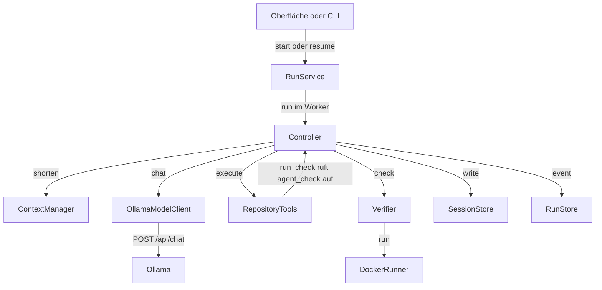
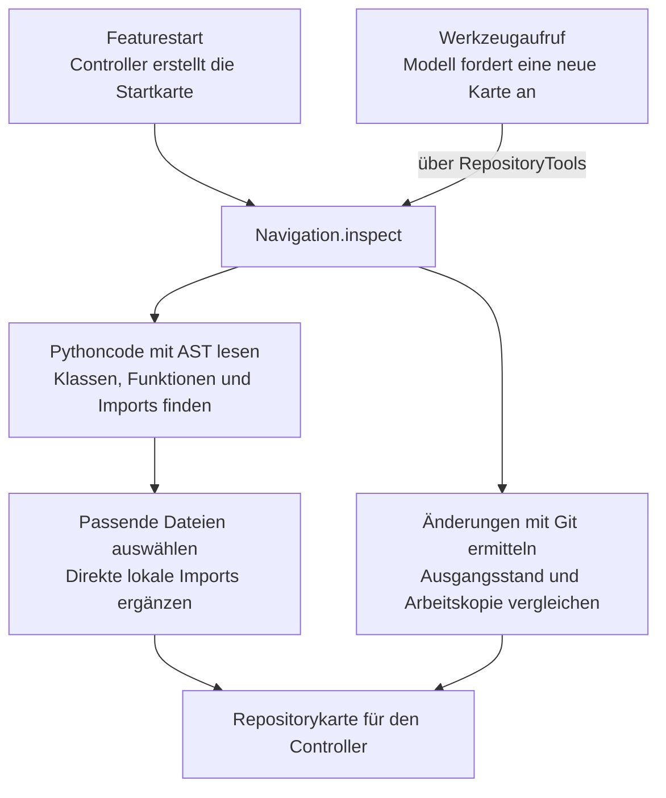
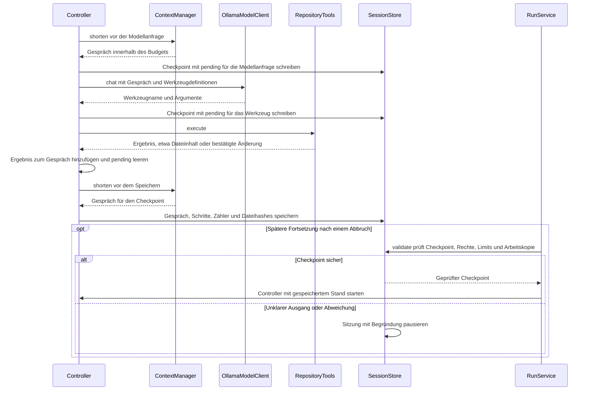

# Coding Harness für Stage 2

Mit diesem Pythonprojekt kann ein lokales Ollama-Modell eine Programmieraufgabe bearbeiten. Der Harness lässt das Modell Dateien untersuchen und ändern. Tests laufen in Docker. Die Oberfläche zeigt den Verlauf, die Änderungen und die Prüfergebnisse. Eine abgebrochene Sitzung kann aus einem geprüften Checkpoint fortgesetzt werden.

Die Aufgabenstellung liegt unter [docs/assignment](docs/assignment/stage-2-coding-harness.pdf). Die folgenden Schritte sind für Windows und PowerShell beschrieben. Getestet wurde mit Python 3.13.2. Unter Linux oder macOS wird statt `py -3.13` der Befehl `python3.13` und statt `.venv\Scripts\python.exe` der Pfad `.venv/bin/python` verwendet. Diese Systeme wurden hier nicht separat geprüft.

## Schritt 1. Voraussetzungen installieren

Benötigt werden Python 3.13, Git, Docker und Ollama. Unter Windows muss Docker Desktop mit Linux-Containern laufen. Docker und Ollama müssen vor dem ersten Lauf gestartet sein. Die Installation der Pythonpakete, das Laden des Modells und die erste Einrichtung benötigen Internetzugang. Ein Modellkonto oder API-Schlüssel ist nicht nötig.

Der belegte Modelllauf verwendet `qwen3.8:27b`. Er wurde auf einer AMD Radeon RX 7900 XTX mit 24 GB Grafikspeicher ausgeführt. Das Modell ist groß und braucht entsprechend viel Speicher. Für einen Rechner mit weniger Speicher kann beispielsweise `qwen2.5-coder:7b` verwendet werden. Das ist der voreingestellte Modellname. Ein kleineres Modell kann bei derselben Aufgabe andere Ergebnisse liefern. Die automatisierten Harness-Tests benötigen kein Modell und keine dedizierte Grafikkarte.

## Schritt 2. Repository klonen und Pythonpakete installieren

Ein PowerShell-Terminal in dem Ordner öffnen, in dem das Projekt gespeichert werden soll. Dann das Repository klonen und in den Projektordner wechseln.

```powershell
git clone https://github.com/MichaelReichenberger/coding-harness.git
cd coding-harness
```

Mit `git checkout --detach COMMIT_ID` den in der Abgabe angegebenen Commit öffnen. Dabei `COMMIT_ID` durch die vollständige Commit-ID aus der Abgabe ersetzen. So wird genau der eingereichte Stand getestet.

Im aktuellen Ordner liegen jetzt `README.md`, `app.py` und `requirements.lock`. Mit den folgenden Befehlen die Pythonumgebung anlegen und die Pakete installieren. Die virtuelle Umgebung muss nicht aktiviert werden.

```powershell
py -3.13 -m venv .venv
.\.venv\Scripts\python.exe -m pip install -r requirements.lock
```

Die Abhängigkeiten sind in `requirements.lock` mit festen Versionen hinterlegt. Falls bereits eine `.venv` vorhanden ist, kann diese weiterverwendet werden.

## Schritt 3. Modell und Testumgebung vorbereiten

Zuerst Docker Desktop über das Startmenü öffnen und warten, bis die Docker-Engine läuft. Sie muss Linux-Container verwenden. Mit folgendem Befehl prüfen, ob sie erreichbar ist. Die Ausgabe soll `linux` sein.

```powershell
docker info --format '{{.OSType}}'
```

Docker muss bereits vor `setup --build` laufen und während der Docker-Tests, Baseline und Aufgabenläufe weiterlaufen. Für das Anlegen der Pythonumgebung und die Tests ohne `--docker` wird Docker nicht benötigt.

Für den dokumentierten Modelllauf diese Befehle ausführen. Falls Ollama nicht im Hintergrund läuft, zuerst Ollama starten. Bei einer Installation ohne Desktop-App kann dafür `ollama serve` in einem zweiten Terminal laufen.

```powershell
$env:HARNESS_MODEL = 'qwen3.8:27b'
ollama pull $env:HARNESS_MODEL
.\.venv\Scripts\python.exe -m harness setup --build
.\.venv\Scripts\python.exe -m harness doctor
```

Wer das kleinere Modell testen möchte, setzt im ersten Befehl stattdessen `qwen2.5-coder:7b`. Die Umgebungsvariable gilt für das aktuelle Terminal. Für die folgenden Befehle dasselbe Terminal verwenden.

`setup --build` lädt den festgelegten Commit der Supermarket Receipt Kata und erstellt das Docker-Image für die Prüfungen. Es ändert den Originalcode der Kata nicht. `doctor` prüft Pythonpakete, Git, Docker, den Zielcommit und das installierte Modell. Für einen echten Modelllauf sollen `core_tests_ready`, `sandbox_ready` und `live_ready` jeweils `true` sein. Die Diagnose prüft die Erreichbarkeit der Dienste. Sie garantiert keine bestimmte Modellgeschwindigkeit oder ausreichenden Grafikspeicher.

## Schritt 4. Automatisierte Tests ausführen

Die erste Prüfung testet den Harness ohne ein laufendes Modell und ohne Docker. Die Docker-Fälle werden dabei ausdrücklich übersprungen.

```powershell
.\.venv\Scripts\python.exe -m pytest -q
```

Danach die gesamte Suite einschließlich der echten Docker-Tests ausführen. Dafür müssen Schritt 3 und der Docker-Start abgeschlossen sein. Auch diese Tests benötigen kein Modell. Modellantworten werden hier durch feste Testantworten ersetzt.

```powershell
.\.venv\Scripts\python.exe -m pytest -q --docker
```

Die Docker-Tests prüfen unter anderem den Zugriffsschutz, den Abbruch von Kindprozessen und die Korrektur eines zunächst fehlschlagenden Features. Die Ergebnisse der aktuellen Abnahme stehen in [docs/verification.md](docs/verification.md).

## Schritt 5. Ausgangszustand prüfen

```powershell
.\.venv\Scripts\python.exe -m harness baseline --project supermarket --profile feature
```

Beim unveränderten Zielprojekt muss `feature` fehlschlagen, weil die Servicegebühr noch nicht existiert. `regression_core`, `regression_pricing` und `lint` sollen bestehen. Der Zustand `baseline_checked` und der Exit-Code 0 bestätigen diese erwartete Ausgangslage. Das ist noch keine erfolgreiche Umsetzung des Features.

## Schritt 6. Oberfläche starten und eine Aufgabe bearbeiten

```powershell
.\.venv\Scripts\python.exe -m streamlit run app.py --server.address 127.0.0.1
```

Im Browser [http://127.0.0.1:8501](http://127.0.0.1:8501) öffnen. Links das Projekt `supermarket` und die Aufgabenart `feature` wählen. Den installierten Modellnamen prüfen. Den vollständigen Text aus [docs/feature-prompt.txt](docs/feature-prompt.txt) in das Aufgabenfeld kopieren und auf „Lauf starten“ klicken.

Unter „Verlauf“ werden Modellanfragen, Werkzeugaktionen, Prüfungen und Zustandswechsel angezeigt. „Dateien & Diff“ zeigt die Änderungen. Unter „Checks“ bleiben auch frühere Fehlversuche sichtbar. Der Zustand `passed` wird erst gesetzt, wenn die unabhängigen Endprüfungen bestanden sind. Ein Lauf kann wegen eines fehlgeschlagenen Checks oder eines verbrauchten Limits enden. Ein anderes Modell muss die Aufgabe nicht innerhalb der 40 erlaubten Aktionen lösen.

## Schritt 7. Abbrechen, öffnen und sicher fortsetzen

Während des Laufs auf „Abbrechen“ klicken und auf den Zustand `cancelled` warten. Um auch den Erhalt eigener Änderungen zu prüfen, vorher im Verlauf auf mindestens eine erfolgreiche Aktion `replace_text` warten.

„Gespeicherte Sitzungen öffnen und fortsetzen“ aufklappen und dieselbe Lauf-ID auswählen. Zuerst „Sitzung öffnen“ und dann „Sicher fortsetzen“ klicken. Der Harness prüft den gespeicherten Zustand und arbeitet mit den bisherigen Änderungen und Zählern weiter. Die Limits beginnen nicht erneut bei null.

Bei geänderten Dateien, abweichenden Einstellungen oder einer unsicher unterbrochenen Aktion wird die Fortsetzung blockiert und die Sitzung pausiert. Ein hart beendeter Prozess kann einen solchen unklaren Zwischenstand hinterlassen. Abgeschlossene Sitzungen mit `passed` oder `baseline_checked` lassen sich öffnen, benötigen aber keine Fortsetzung. Zum Beenden der Oberfläche zuerst einen aktiven Lauf sauber abbrechen und danach im Terminal Strg+C drücken.

## Einstellungen ändern

Optional `config.example.toml` nach `config.local.toml` kopieren und dort Modell, Adresse und Limits anpassen. Die lokale Datei wird nicht mit abgegeben. `HARNESS_MODEL`, `HARNESS_OLLAMA_BASE_URL` und `HARNESS_NUM_GPU` haben Vorrang vor der Datei.

Die Gerätewahl übernimmt normalerweise Ollama. `HARNESS_NUM_GPU=0` fordert ausdrücklich CPU-Betrieb an. Der Harness erkennt einen automatischen CPU-Rückfall von Ollama nicht selbst. Mit `ollama ps` kann während einer Modellanfrage die tatsächliche Belegung geprüft werden.

Im Featureprofil ist der vollständige Modellrequest auf höchstens 32.768 UTF-8-Bytes begrenzt. Bei ausdrücklich eingestelltem CPU-Betrieb sind es höchstens 16.384 Bytes. Der kleinere Wert aus diesem Profilbudget und `limits.context_bytes` gilt. Das Bytebudget ist von Ollamas Modellfenster mit 16.384 Tokens zu unterscheiden.

Für eine Vorführung der Kontextkürzung kann in `config.local.toml` unter `[limits]` der Wert `context_bytes = 16384` gesetzt werden. Danach die Oberfläche neu starten und eine neue Feature-Sitzung beginnen. Sobald das Budget überschritten wird, erscheint im Verlauf „Kontext gekürzt“. Bei zu wenig Platz für Auftrag und Regeln stoppt der Harness. Bestehende Sitzungen werden bei abweichenden Einstellungen nicht einfach fortgesetzt.

Die übrigen Standardgrenzen sind 40 Werkzeugaktionen, 50 Runden, zwei Wiederholungen pro fehlerhafter Modellanfrage, 180 Sekunden pro Modellanfrage und 120 Sekunden pro Check. Ausgaben sind auf 64 KiB und einzelne Dateien auf 256 KiB begrenzt. Ereignisse, Bericht, Diff und Checkpoint teilen sich ein Artefaktbudget von 8 MiB. Arbeitskopien sind davon getrennt.

## Bedienung über das Terminal

Die gleichen Aufgaben können ohne Oberfläche ausgeführt werden. Den Feature-Prompt aus der mitgelieferten Textdatei laden und einen neuen Lauf starten.

```powershell
$task = Get-Content -Raw -Encoding utf8 docs/feature-prompt.txt
.\.venv\Scripts\python.exe -m harness run --project supermarket --profile feature --task $task
.\.venv\Scripts\python.exe -m harness sessions
```

Zum Öffnen, Abbrechen oder Fortsetzen `SITZUNGS_ID` durch eine angezeigte Lauf-ID ersetzen. Den Abbruchbefehl bei einem aktiven CLI-Lauf in einem zweiten Terminal ausführen. Strg+C im laufenden CLI-Befehl fordert ebenfalls einen sauberen Abbruch an.

```powershell
.\.venv\Scripts\python.exe -m harness inspect SITZUNGS_ID
.\.venv\Scripts\python.exe -m harness cancel SITZUNGS_ID
.\.venv\Scripts\python.exe -m harness resume SITZUNGS_ID
```

## Aufbau und Prüfumfang

`app.py` und `harness/__main__.py` enthalten die Oberfläche und CLI. `RunService` verbindet beide mit dem Controller. Der Controller steuert die Modellschleife, Grenzen, Checkpoints und Endprüfungen. Die [Diagramme](#diagramme) zeigen die wichtigsten Aufrufe. Die Designentscheidungen stehen in der [Designbeschreibung](docs/stage-2-design.md).

Das Profil `bugfix` erhält die Stage-1-Aufgabe für gedruckte Stückmengen. `feature` ergänzt die optionale Servicegebühr über Kasse und Beleg und verwendet zusätzlich einen Syntaxcheck. Beide Profile verwenden die bestehenden Regressionstests. Die Geschäftsregeln und die vorbereiteten Prüfungen sind in [docs/task.md](docs/task.md) beschrieben. Für beliebige andere Aufgaben müssen passende geschützte Akzeptanztests vorbereitet werden. Grüne vorhandene Checks beweisen keine zusätzlichen Anforderungen eines frei eingegebenen Prompts.

Nur das öffentliche Projekt aus `config/target.json` ist freigegeben. Das Modell darf sechs vorhandene Anwendungsdateien ändern. Es erhält keine Shell und keine Werkzeuge für Push, Merge oder Deployment. Zielcode wird nur in einem begrenzten Docker-Container ausgeführt. Der Harness ist für einen vertrauenswürdigen lokalen Benutzer gedacht. Der gespeicherte Checkpoint ist nicht gegen absichtliche Änderungen durch diesen Benutzer signiert.

Sitzungen liegen unter `.harness/runs/ID`. Dort stehen `session.json`, `events.jsonl`, `report.json`, `changes.diff` und die Arbeitskopien. Die vollständigen Belege eines echten erfolgreichen Modelllaufs sind unter [docs/evidence/stage-2](docs/evidence/stage-2/report.json) enthalten. Sie dokumentieren einen Lauf auf dem damaligen Stand. Die aktuelle Testabnahme wird getrennt festgehalten.

## Herkunft und Unterstützung

Der Harness baut auf der eigenen Stage-1-Implementierung auf. Das Zielprojekt stammt aus der [Supermarket Receipt Kata von Emily Bache](https://github.com/emilybache/SupermarketReceipt-Refactoring-Kata) am Commit `c72d68abd77a417f84193b72a3b8d14177336066`. Die übernommenen Tests, ihre Herkunft und die Lizenz liegen in `checks/upstream`.

OpenAI Codex unterstützte Analyse, Implementierung, Tests und Dokumentation. Die Akzeptanztests wurden vor dem Modelllauf vorbereitet. Nach der Auswertung früherer Versuche wurden Prüfungen für große Ganzzahlen ergänzt und `fractions.Fraction` als erlaubte Lösungshilfe im Prompt genannt. Der dokumentierte Modelllauf erhielt keinen fertigen Patch. Sein Zielcode wurde nicht von Hand korrigiert. Diese Angaben gehören zum geforderten Nachweis der verwendeten Unterstützung.

## Diagramme

### Architektur

Die Pfeile zeigen, wer wen aufruft. Fordert das Modell einen Check an, führt der Weg von den Dateiwerkzeugen zurück zum Controller. Für die Baseline und die Endprüfung ruft der Controller den Verifier selbst auf.



### Navigation

Beim Start einer Featureaufgabe erstellt der Controller die erste Karte mit den ersten 200 Zeichen des Auftrags als Suchtext. Fordert das Modell später mit `inspect_repository` eine neue Karte an, leitet der Controller die Suche über `RepositoryTools` weiter. Beide Wege nutzen dieselbe Navigation.



Die Karte enthält eine Übersicht über bis zu 80 Pythonmodule, den Git-Zustand und eine Leseempfehlung. Dafür wählt die Navigation bis zu vier Suchtreffer und ergänzt deren direkte lokale Abhängigkeiten auf insgesamt höchstens sechs Dateivorschläge.

### Kontext und Sitzungen

Im Featureprofil misst der ContextManager die Größe der vollständigen Modellanfrage. Bei Bedarf kürzt er ältere Nachrichten. Auftrag, Regeln und Akzeptanzkriterien bleiben erhalten. Der Controller erhält das Gespräch zurück und sendet es über den Modellclient an Ollama. Der erste Teil zeigt eine Runde mit einem Dateiwerkzeug. Nach `finish` folgen die unabhängigen Endprüfungen.


