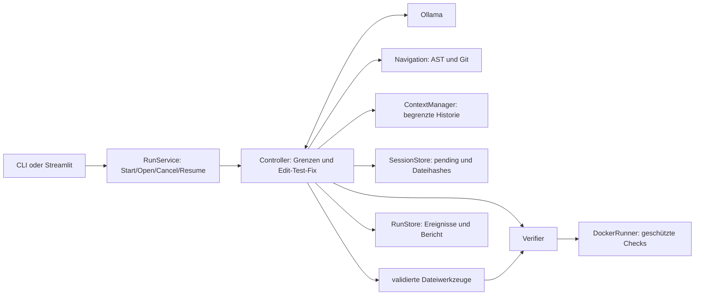

# Coding Harness · Stage 2

Eigener Python-Harness für lokale Ollama-Modelle: Aufgabe eingeben, relevante Module
finden, begrenzt editieren und in Docker prüfen. Sitzungen lassen sich nach einem
sauberen Abbruch öffnen und mit bereits verbrauchten Limits fortsetzen.

Maßgeblich: [Stage-2-PDF](docs/assignment/stage-2-coding-harness.pdf).
[Anforderungsmatrix](docs/requirements-matrix.md) · [jede Dateiänderung mit Begründung](docs/stage-2-changes.md)
· [Prüfstand](docs/implementation-status.md) · [Featureauftrag](docs/stage-2-task.md).

## Einrichtung

Python 3.12, Git, Docker Desktop mit Linux-Engine und Ollama mit bereits installiertem
Modell sind nötig. Ollama läuft auf dem Host; nur Zielcode und Checks laufen in Docker.
Es gibt keinen Modell-Download durch den Harness, keine API-Keys und kein Agentenframework.

```powershell
py -3.12 -m venv .venv
.\.venv\Scripts\python.exe -m pip install -r requirements.lock
.\.venv\Scripts\python.exe -m harness setup --build
.\.venv\Scripts\python.exe -m harness doctor
.\.venv\Scripts\python.exe -m streamlit run app.py --server.address 127.0.0.1
```

UI: http://127.0.0.1:8501/. Projekt und Aufgabenart wählen, installierten Modellnamen
angeben, eigenen Prompt ins leere Feld schreiben. Fortschritt, Abbruch, gespeicherte
Sitzungen, Fortsetzen, Diff und Checks sind getrennt sichtbar. `Ctrl+C` beendet den Server.
Nach Codeupdates einen alten Streamlit-Prozess neu starten.
Linux: `python3.12 -m venv .venv`, danach `.venv/bin/python` verwenden.

`config.example.toml` kann nach `config.local.toml` kopiert werden. Umgebungsvariablen
`HARNESS_MODEL`, `HARNESS_OLLAMA_BASE_URL` und optional `HARNESS_NUM_GPU` haben Vorrang.
`HARNESS_NUM_GPU=0` nutzt CPU nur für diese Anfragen, etwa bei einem defekten CUDA-Runner;
der Standard überlässt die Gerätewahl Ollama. Das Setting wird im Checkpoint mitvalidiert. Standard: installiertes
`qwen2.5-coder:7b`, Temperatur 0, Modellkontext 16.384 Tokens, maximal 4.096 erzeugte
Tokens pro Anfrage. Diese Werte und die vorhandene JSON-Werkzeugschnittstelle gelten
auch für Stage 2; Modellantworten sind nicht garantiert identisch oder erfolgreich.

## Projekt, Feature und Stage-1-Kompatibilität

Die Allowlist enthält `supermarket`: Python-Teil der öffentlichen
[Supermarket Receipt Kata](https://github.com/emilybache/SupermarketReceipt-Refactoring-Kata),
Commit `c72d68abd77a417f84193b72a3b8d14177336066`. Es gibt mehrere zusammenarbeitende
Module, echte Preis-/Rabattregeln und unveränderte Upstream-Tests.
Frei eingegebene Hostpfade oder neue Projekt-URLs werden nicht akzeptiert.

- `bugfix`: bestehende Stage-1-Aufgabe für gedruckte Stückmengen und die bisherigen drei Checks.
- `feature`: optionale Servicegebühr durch Kasse und Beleg; alte Aufrufe bleiben gültig,
  ungültige Gebühren liefern ValueError. Vier geschützte Checks einschließlich Syntaxlint.

Die Feature-Baseline ist rot, weil das optionale API im Originalcommit fehlt. Sie wird
nicht durch einen künstlichen Bug erzeugt. Die Featureprüfung behauptet keine
Reparatur des unabhängigen Stückmengenfehlers. Ein beliebiger neuer Nutzerauftrag
benötigt eigene vorbereitete geschützte Akzeptanzchecks.

```powershell
$env:HARNESS_MODEL = 'qwen2.5-coder:7b'
.\.venv\Scripts\python.exe -m harness projects
.\.venv\Scripts\python.exe -m harness baseline --profile feature
.\.venv\Scripts\python.exe -m harness run --project supermarket --profile feature --task 'Dein Featureauftrag'
.\.venv\Scripts\python.exe -m harness sessions
.\.venv\Scripts\python.exe -m harness inspect SITZUNGS_ID
.\.venv\Scripts\python.exe -m harness cancel SITZUNGS_ID
.\.venv\Scripts\python.exe -m harness resume SITZUNGS_ID
```

Ohne `--profile` bleibt `bugfix` Standard. Alte Stage-1-Befehle funktionieren weiter.
`baseline` bestätigt nur den vorbereiteten fachlichen Fehlschlag bei grünen Kontrollen;
`run`/`resume` melden Erfolg ausschließlich nach unabhängigen grünen Endchecks.

## Navigation und begrenzter Kontext

`inspect_repository` liest per AST Klassen/Funktionen und Imports, bewertet Suchbegriffe
und ergänzt direkte lokale Abhängigkeiten. Es führt keinen Zielcode auf dem Host aus.
Git vergleicht die Archivkopien `base` und `repo` mit `diff --no-index`; Ausgangscommit
und relative Änderungen stehen im Ergebnis. Die Laufkopie enthält keine Git-Zugangsdaten.

Beim Featureprofil kommen eine kleine Repositorykarte und echte Baselinestatus in den
Startkontext. Das Modell wählt seine Dateiwerkzeuge selbst. Trusted bleiben Systemregeln,
Originalauftrag, erlaubte Änderungen und Akzeptanzkriterien. Karte, Quelltext, Toolausgaben
und die deterministische Kurzfassung älterer Schritte bleiben ausdrücklich untrusted.

Das Featureprofil begrenzt den vollständig serialisierten Modellrequest auf
`min(context_bytes, 32768)` (bei explizitem CPU-Betrieb höchstens 16384) UTF-8-Bytes einschließlich Tooldefinitionen und JSON-Escaping.
Bei Überschreitung werden alte Beobachtungen durch eine kurze Liste von Schritten
ersetzt. Die letzte Beobachtung wird nötigenfalls sichtbar gekürzt. Aufgabe und Regeln
werden nie gekürzt: Passen diese allein nicht, stoppt der Harness. Das ist ein
Bytebudget, keine exakte Tokenizerzählung. Stage 1 behält seinen bisherigen Kontext-Stopp.

## Checkpoints und sicheres Fortsetzen

Je Sitzung liegen `session.json`, `events.jsonl`, `report.json` und `changes.diff` unter
`.harness/runs/ID/`; daneben liegen wegwerfbare Quell-/Baselinekopien.
Der atomare Checkpoint speichert Originalauftrag, Projekt/Profil, Startcommit, Scope,
Checks/Testhashes, Modellsettings, Zähler, Schritte, begrenzte Historie und Dateihashes.

Vor Modell-/Tool-/Checkaktionen wird `pending` dauerhaft geschrieben. Erst ein bekanntes
Ergebnis mit abgeschlossenem Cleanup räumt es auf. Nach sauberem Abbruch kann Resume
fortsetzen. Es vergleicht aktuelle Rechte, Tooldefinitionen, Kriterien, Limits, Testhashes,
Baseline und Arbeitskopie mit dem Checkpoint — ausdrücklich einschließlich eigener Edits.
Die Quellkopie wird nicht neu exportiert oder zurückgesetzt. Verbrauchte Zähler bleiben erhalten. Frühere Endchecks werden nach Resume als previous_final geführt; fehlende aktuelle Endchecks bleiben not_run.
Ein anderes Sandbox-Image wird auch nach der Docker-Vorprüfung zurückgewiesen.

Bei Abweichungen, verbrauchten Limits, unsicherem `pending` oder unbestätigtem Containerende
pausiert die Sitzung. Keine unsichere Aktion wird automatisch wiederholt. Bei einem harten
Absturz mitten in einer Aktion ist manuelle Prüfung/ggf. ein neuer Lauf nötig; es gibt
keinen unsicheren „trotzdem fortsetzen“-Schalter. `inspect` und die UI zeigen Diff,
Schritte, Fehler, Checkstatus und offene Arbeit auch nach Neustart.

## Grenzen und Zuständigkeiten



| Datei | Zuständigkeit |
|---|---|
| `controller.py` | Modellschleife, Zähler, Checkpoints, Kontext und unabhängige Endprüfung |
| `navigation.py` | AST-Symbole, Abhängigkeiten, Dateiauswahl und Git-Diff |
| `context.py` | Deterministische Kürzung unter Beibehaltung der trusted Aufgabe |
| `sessions.py` | Atomare Sitzungsdateien, Hashprüfung, Unsicherheit und Pausen |
| `service.py` | Gemeinsame Start-/Resume-/Abbruchlogik und Worker |
| `repository.py` | Registry, Argument-/Pfadprüfung und Dateiwerkzeuge |
| `models.py` | Begrenzte abbrechbare HTTP-Anfragen; Scripted-Client nur in Tests |
| `sandbox.py`, `process.py` | Containergrenzen, feste Befehle, Ausgabe und Cleanup |
| `verifier.py`, `store.py` | Unverfälschte Ergebnisse, Ereignisse und begrenzter Bericht |
| `workspace.py`, `config.py` | Commitexport/Diff/RunLock und vertrauenswürdige Konfiguration |
| `app.py`, `__main__.py` | Oberfläche und CLI ohne eigene Werkzeugausführung |
| `checks/` | Geschützte Bugfix-/Feature-/Regressionschecks; Standardbibliothek-Syntaxlint |
| `tests/` | Offline-Vertragstests und separat wählbare echte Docker-Tests |

Keine Shell für das Modell, keine Push-/Merge-/Deploy-Werkzeuge. Nur die sechs
freigegebenen Dateien sind editierbar; keine Dateierstellung/-löschung. Docker bleibt
nicht-root, ohne Netzwerk, read-only, mit CPU-/RAM-/Prozess-/Zeitlimits. Ein Mutex und
OS-RunLock verhindern parallele Schreibläufe. Abbruch beendet auch Containerkinder.
Die Sitzung ist für einen lokalen vertrauenswürdigen Benutzer; Checkpoints sind keine
signierten Mehrbenutzerdaten. Ein Container ist keine VM und die Prüfung absichtlich
bösartigen Zielcodes kein unabhängiger Beweis; deshalb den Diff prüfen.

Standardbudgets: 40 Aktionen, 50 Runden, 2 Retrys/Anfrage, 180 s/Modell, 120 s/Check,
64 KiB Ausgabe, 256 KiB/Datei. Vom Artefaktbudget (8 MiB) erhält jedes der vier Elemente
Ereignisse/Bericht/Diff/Checkpoint ein Viertel. Quellkopien und Release-ZIP zählen separat; atomare Temporärdateien können kurzzeitig zusätzlich anfallen.
Kein weiteres Modell fasst Texte zusammen; es gibt keine neue Runtime-Abhängigkeit.

## Tests, Nachweise und Credits

```powershell
.\.venv\Scripts\python.exe -m pytest -q
.\.venv\Scripts\python.exe -m pytest -q --docker -m docker
.\.venv\Scripts\python.exe -m ruff check harness app.py tests checks/entry.py checks/feature.py
```

Coretests verwenden Scripted-Antworten und benötigen kein Modellkonto/API-Key.
Docker-Tests werden ohne `--docker` ausdrücklich ausgelassen. Feste Reparaturantworten
gibt es nur in Tests; der echte Modellnachweis wird separat dokumentiert. Fehlende
Infrastruktur wird nie durch Host-Ausführung ersetzt. Aktuelle Ergebnisse und konkrete
Restschritte stehen im [Implementierungsstand](docs/implementation-status.md).

Ausgangscode: öffentlicher Kata-Commit und Lizenz/Originaltests in `checks/upstream/`.
Eigener Harness auf Basis der vorhandenen Stage-1-Implementierung; OpenAI Codex half
bei Analyse, Implementierung, Tests und Dokumentation. Geschützte Featuretests und
Aufgabenbeschreibung wurden manuell durch den Implementierungsassistenten vorbereitet;
der echte Modelllauf erhält keinen Patch. [Video-Drehbuch](docs/demo-script.md), maximal
vier Minuten; Aufnahme und Moodle-Abgabe bleiben durch den Nutzer auszuführen.

Technische Referenzen: [Ollama-Fehlerdiagnose](https://docs.ollama.com/troubleshooting),
[offizielles num_gpu-Requestfeld](https://github.com/ollama/ollama/blob/main/api/types.go).
Ausführliches [Checkpoint-/Kontextdesign](docs/stage-2-design.md).
