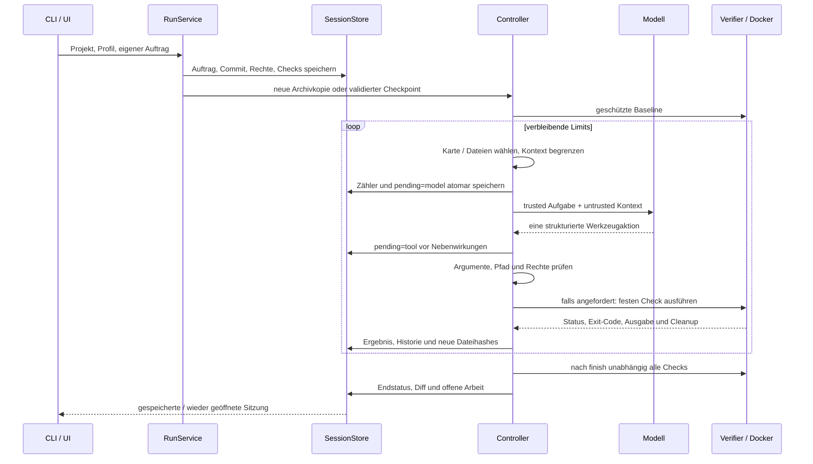

# Stage-2-Design und Sicherheitsentscheidungen

## Verantwortung und Datenfluss

## Navigation und Git-Zustand

`Navigation` nutzt `RepositoryTools.files/read`: dieselbe Pfadgrenze, Dateigröße,
UTF-8-/Binärprüfung und Symlink-/Junctionsperre gelten für AST-Navigation und Lesen.
AST-Parsing liefert Methoden-/Klassennamen mit Zeilen und Importabhängigkeiten;
Syntaxfehler werden als Daten zurückgegeben. Zielcode wird dabei nicht importiert.
Ein einfacher Namensscore wählt bis zu vier Trefferdateien plus direkte lokale
Abhängigkeiten (insgesamt höchstens sechs). Keine externe Suchdatenbank oder LSP.

Die Laufkopie stammt aus `git archive`, enthält kein .git und keine Remotezugänge.
`git diff --no-index --no-ext-diff --no-textconv --name-status base repo` zeigt den
aktuellen Unterschied; Commit und relative Änderungen bleiben dokumentiert.
Es wird kein Git-Hook oder externer Diff-Treiber des Zielrepos ausgeführt.

## Kontext und Vertrauen

Trusted bleiben die Systemanweisungen und der unveränderte Nutzerauftrag mit Scope,
Checknamen und vorbereiteten fachlichen Akzeptanzkriterien. Das Featureprofil fügt
Karte/Baselinestatus als ausdrücklich untrusted User-Beobachtung hinzu. Der Agent
findet und liest den Code selbst. Auch Schritte aus der alten Historie bleiben Daten.

Das Featurebudget beträgt höchstens 32.768 UTF-8-Bytes (CPU-Override: 16.384) bzw. ein kleineres konfiguriertes
`context_bytes`-Limit. Gezählt wird der serialisierte Ollama-Request samt Werkzeug-Schema
und Escapezeichen, nicht nur der sichtbare Text. Älteste Beobachtungen werden durch
eine deterministische, begrenzte Schrittliste ersetzt; nötigenfalls wird die letzte
Beobachtung markiert gekürzt. Trusted Vorgaben passen entweder vollständig oder der
Lauf stoppt klar. Stage 1 behält seinen bisherigen Kontextlimit-Stopp. Die Rohereignisse
liegen innerhalb ihres eigenen Budgets weiterhin im Sitzungsprotokoll.

## Checkpoint-Protokoll

1. `RunService` erwirbt den OS-RunLock und prüft unbestätigte Container.
2. Der Controller speichert pending und bereits erhöhte Zähler VOR einer Modell-,
   Datei- oder Checkaktion. session.tmp wird geschrieben, geflusht und per fsync
   gesichert; replace tauscht session.json atomar aus.
3. Nach bekannter Rückkehr speichert er Beobachtungen/Ergebnisse und neue Hashes.
   Eigene erfolgreiche Edits ersetzen damit ausdrücklich den alten Sollzustand.
4. Sauberer Abbruch wartet auf die HTTP-Coroutine bzw. den Container-Cleanup und
   hinterlässt einen sicheren Checkpoint. Ein fremder CLI-Prozess kann über cancel
   eine Anforderung setzen; ein kleiner Watcher unterbricht auch laufende HTTP-Requests.
5. Nach hartem Prozessabsturz bleibt pending stehen. Öffnen zeigt die unsichere Aktion;
   Resume pausiert und wiederholt sie nie automatisch. Manuelle Prüfung oder neuer Lauf.

Resume vergleicht Project-Allowlist, Target/Commit, Editierbereich, Tooldefinitionen,
Akzeptanzkriterien, Checks/Testhashes, Modellsettings und Limits. Alle Zähler werden
übernommen. Die aktuelle Arbeitskopie und die unveränderte Baseline müssen zum
Checkpoint passen; neue Dateien, Links/Hardlinks und Baselineänderungen pausieren.
Nach Docker-Vorprüfung wird außerdem die gespeicherte Image-ID verglichen.
Ein neues Modell-/CPU-Setting kann daher nicht unbemerkt die alte Policy ersetzen.
Es gibt keinen Reset auf Originalcode und keinen unsicheren Bestätigungs-Schalter.

`SessionStore` ist eine lokale Einbenutzerablage außerhalb des Agentenbereichs, keine
signierte Datenbank gegen Angriffe des angemeldeten Benutzers. Sitzungs-IDs sind streng
validiert, Datenmengen begrenzt und Dateilinks bei der Zustandsprüfung verboten.

## Prüfung und Grenzen

Die Feature-Checks sind eine eigene fachliche Aufgabe; sie ersetzen keine bestehende
Bugfix-Akzeptanz. Stage 1 bleibt im Profil bugfix aktiv. Die Verifikation bewertet
CheckResult mit Status, Exit-Code, Timeout, Abbruch und Cleanup — keine Modellbehauptung.
Failed/unavailable/not_run bleiben sichtbar. Syntaxlint läuft in Docker mit AST; es
ersetzt keinen Stil-/Typchecker. Ein zusätzlicher Build ist hier nicht nötig.

Die bestehende Dockergrenze bleibt unverändert: UID 10001, keine Capabilities, kein
Netz/Docker-Socket/Secrets, read-only Root-/Repo-/Testmounts, begrenzte tmpfs/CPU/RAM/
Prozesse. Das aktive Containerregister blockiert weitere Starts, wenn Cleanup nicht
bestätigt ist. Alle Aktionen, Ablehnungen und Transportwiederholungen zählen weiter.

Das Artefaktbudget verteilt sich auf Ereignisse, Bericht, Diff und Checkpoint zu je
einem Viertel. Zu große Texte werden sichtbar gekürzt; ein zu großer Checkpoint führt
zum sicheren Stopp. Quellkopien und Release-ZIP liegen außerhalb dieses Laufbudgets; atomare Temporärdateien können kurzzeitig zusätzlich anfallen.
Echte Modellleistung kann trotz Temperatur 0 schwanken. Ein deterministischer
Scripted-Rot-Grün-Test ist ausdrücklich kein Ersatz für den echten Featurelauf.
